# Claims Rule Flowcharts

*Portfolio project · FWA claims rule engine*

How each of the 32 rules decides what to report: 5 judge whole claims,
27 judge individual service lines. Every rule runs on paid lines only. Each diagram
reads top to bottom.

Grey boxes are processing steps, coral boxes are what gets reported (with the note it carries),
green boxes pass or are out of the rule's scope, and dashed boxes are handled by a sibling rule.

[Back to the case study](README.md) · [Web version of this page](https://omarzedan98.github.io/fwa-claims-rule-engine/rule-flowcharts.html)

## Rule index

**Claim level · 5 rules**

- [C1 Duplicate Claim](#c1-duplicate-claim)
- [C2 Member Treated at Multiple Providers, Same Day](#c2-member-treated-at-multiple-providers-same-day)
- [C3 Cloned Claims](#c3-cloned-claims)
- [C4-1 Physician Daily Capacity Breach (doubtful)](#c4-1-physician-daily-capacity-breach-doubtful)
- [C4-2 Physician Daily Capacity Breach (confirmed)](#c4-2-physician-daily-capacity-breach-confirmed)

**Service level · 27 rules**

- [S1 Duplicate Service](#s1-duplicate-service)
- [S2 Repeat Consultation Within 14 Days](#s2-repeat-consultation-within-14-days)
- [S3 Service Frequency Breach](#s3-service-frequency-breach)
- [S4 Excessive Radiology](#s4-excessive-radiology)
- [S5 Exceeds Maximum Daily Limit](#s5-exceeds-maximum-daily-limit)
- [S6 Unreasonable Quantity](#s6-unreasonable-quantity)
- [S7 Duplicated Service Within 7 Days](#s7-duplicated-service-within-7-days)
- [S8 Diagnosis Outside Age Range](#s8-diagnosis-outside-age-range)
- [S9 Diagnosis Gender Mismatch](#s9-diagnosis-gender-mismatch)
- [S10 Isolated Consultation Visit](#s10-isolated-consultation-visit)
- [S11 Excessive Consultation Frequency](#s11-excessive-consultation-frequency)
- [S12 Invalid ICD-10 Code](#s12-invalid-icd-10-code)
- [S13 Inactive ICD-10 Code](#s13-inactive-icd-10-code)
- [S14 Not Valid Principal Diagnosis](#s14-not-valid-principal-diagnosis)
- [S15 Service / Gender Mismatch](#s15-service--gender-mismatch)
- [S16 Service / Age Mismatch](#s16-service--age-mismatch)
- [S17-1 Therapeutic Duplication, Same Active Ingredient](#s17-1-therapeutic-duplication-same-active-ingredient)
- [S17-2 Therapeutic Duplication, Same Chemical Subgroup](#s17-2-therapeutic-duplication-same-chemical-subgroup)
- [S17-3 Therapeutic Duplication, Same Pharmacological Subgroup](#s17-3-therapeutic-duplication-same-pharmacological-subgroup)
- [S18-1 More Than 5% Unlisted SBS Codes](#s18-1-more-than-5-unlisted-sbs-codes)
- [S18-2 More Than 3% Unlisted Drugs](#s18-2-more-than-3-unlisted-drugs)
- [S19-1 Service Too Frequent Use, Provider Level](#s19-1-service-too-frequent-use-provider-level)
- [S19-2 Service Too Frequent Use, Physician Level](#s19-2-service-too-frequent-use-physician-level)
- [S20-1 Phantom Billing](#s20-1-phantom-billing)
- [S20-2 Missed Chief Complaint](#s20-2-missed-chief-complaint)
- [S21 Service Outside Coverage](#s21-service-outside-coverage)
- [S22 Excessive Member Visits](#s22-excessive-member-visits)

## C1 Duplicate Claim

Two or more claims for the same patient on the same day billing exactly the same set of services.

| | |
|---|---|
| **Level** | Claim |
| **Key settings** | Consultation lines include the physician, so the same code by two doctors is not a duplicate. The lowest claim ID is treated as the original. |
| **Reference data** | None |

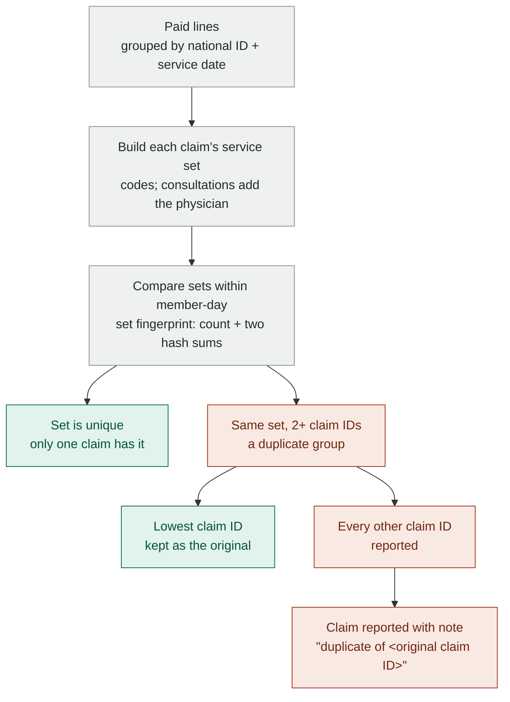

[Back to the rule index](#rule-index)

## C2 Member Treated at Multiple Providers, Same Day

A patient with paid consultation lines at two or more different providers on one day.

| | |
|---|---|
| **Level** | Claim |
| **Key settings** | Providers are counted distinctly. Two visits at the same provider are S1's business, not C2's. |
| **Reference data** | None |

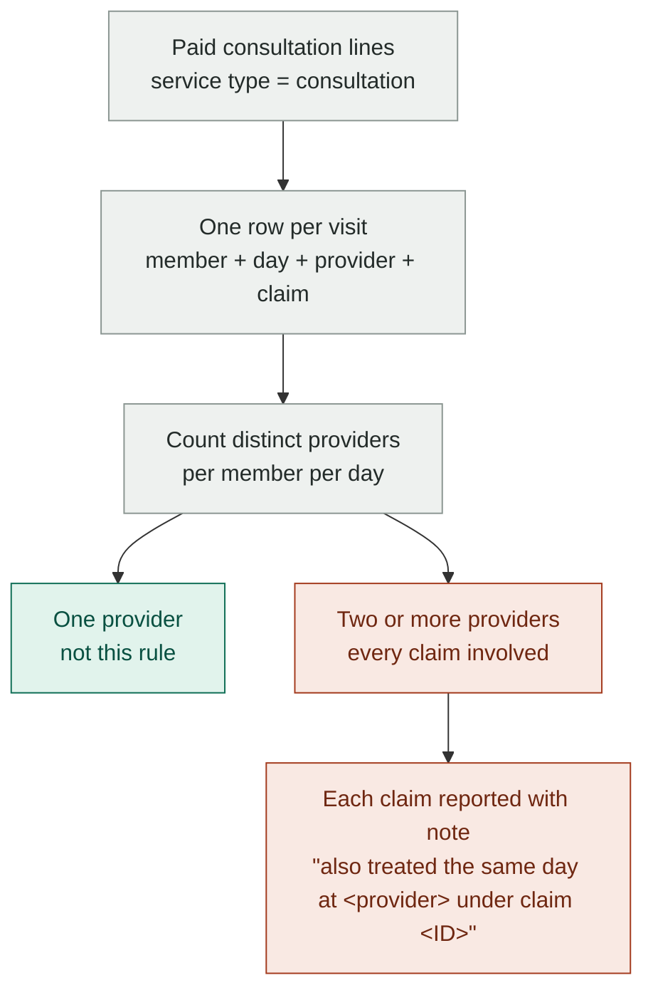

[Back to the rule index](#rule-index)

## C3 Cloned Claims

The same provider, anywhere in the file, billing an identical set of services, principal diagnoses and chief complaint for different patients.

| | |
|---|---|
| **Level** | Claim |
| **Key settings** | No month limit: copies months apart still match. Every claim in a cloned set is reported (a pair gives 2, a set of 3 gives 3), because no patient's claim can be treated as the genuine one. Secondary diagnoses are not compared. |
| **Reference data** | None |

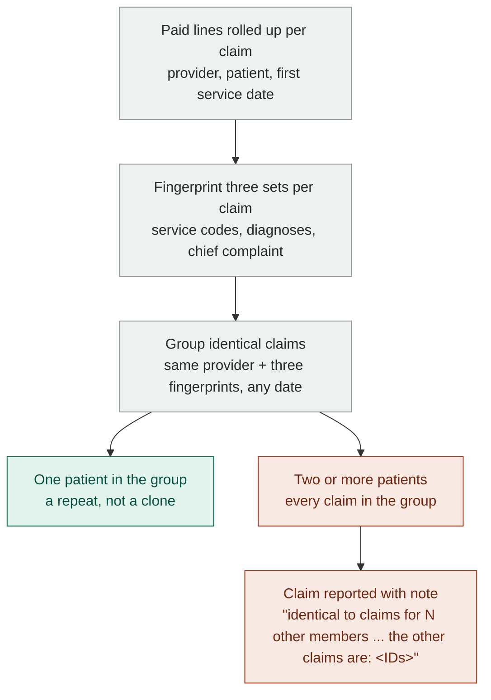

[Back to the rule index](#rule-index)

## C4-1 Physician Daily Capacity Breach (doubtful)

A physician seeing more than 40 different patients in consultation on one day.

| | |
|---|---|
| **Level** | Claim |
| **Key settings** | Counted on distinct patients, consultation lines only. Days of 60 or more are left to C4-2. |
| **Reference data** | None |

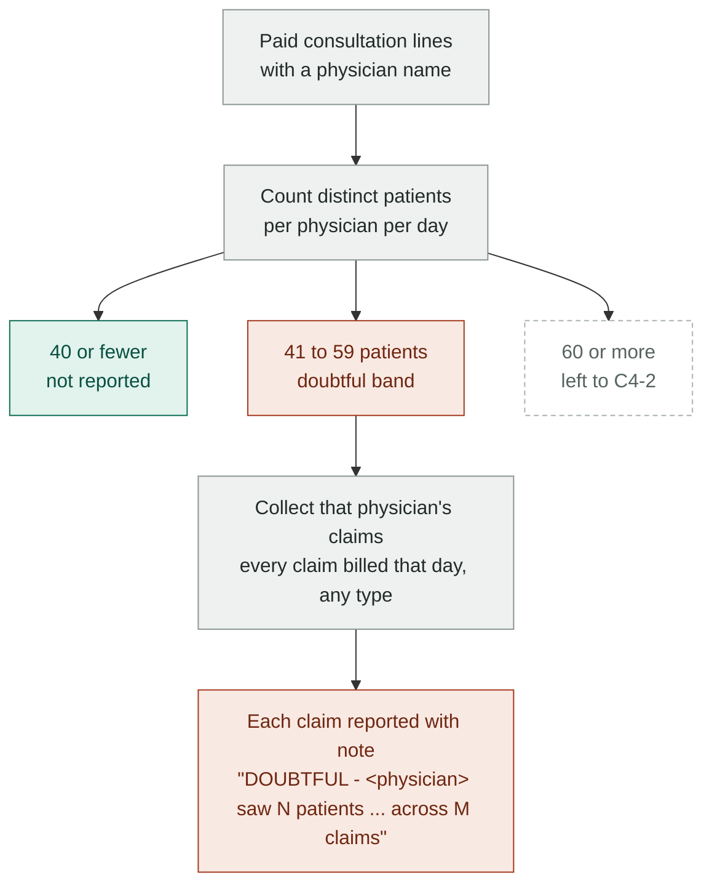

[Back to the rule index](#rule-index)

## C4-2 Physician Daily Capacity Breach (confirmed)

A physician seeing 60 or more different patients in consultation on one day.

| | |
|---|---|
| **Level** | Claim |
| **Key settings** | Same count as C4-1, upper band only. |
| **Reference data** | None |

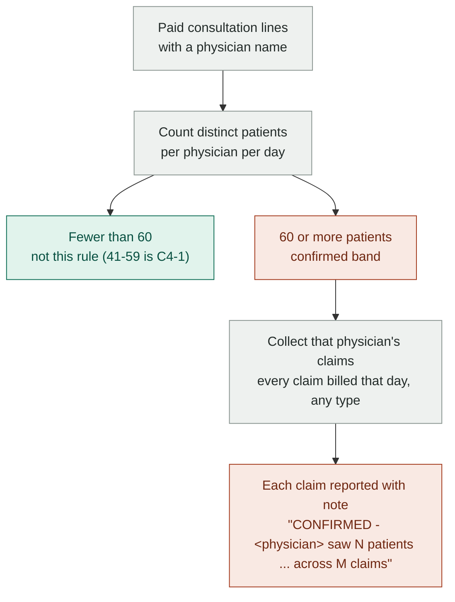

[Back to the rule index](#rule-index)

## S1 Duplicate Service

The same service billed more than once for the same patient on the same day.

| | |
|---|---|
| **Level** | Service line |
| **Key settings** | Two keys, both with the tooth number: blank on both lines for non-dental work, so it drops out. Non-consultation lines are compared across service types, so dental work typed SRVS is keyed by tooth too. For consultations the cheapest line is kept and the dearer ones are reported. |
| **Reference data** | None |

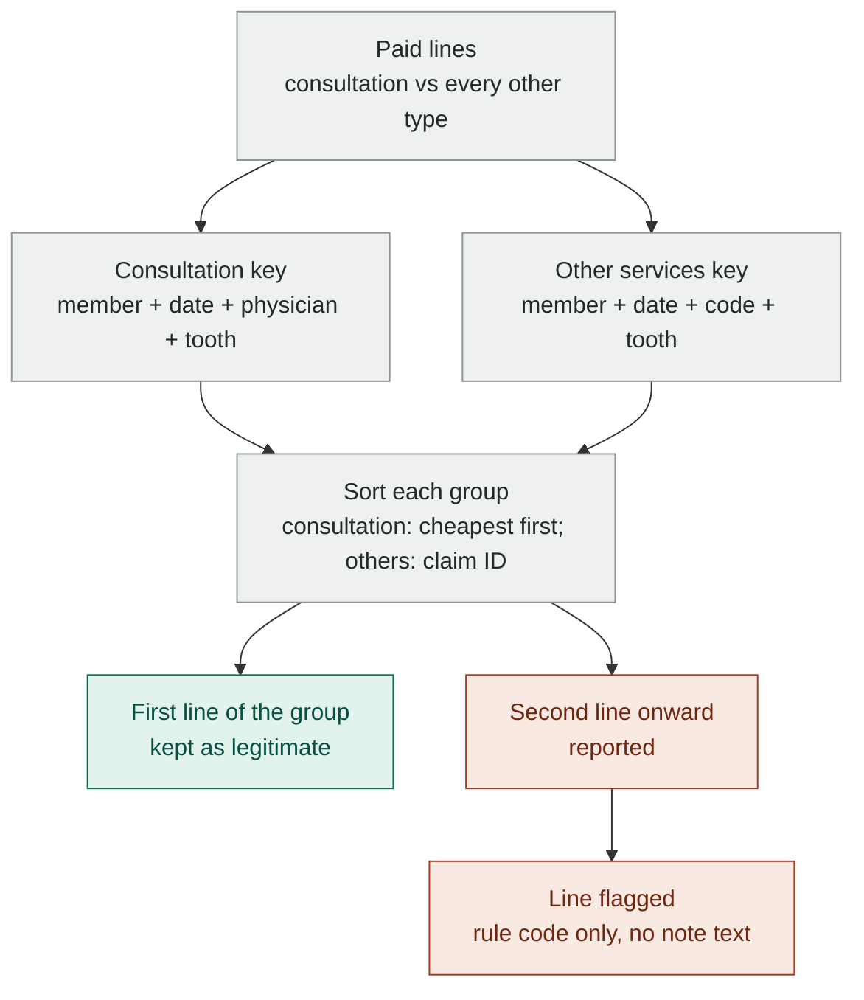

[Back to the rule index](#rule-index)

## S2 Repeat Consultation Within 14 Days

The same patient seen again by the same physician 1 to 14 days after the previous visit.

| | |
|---|---|
| **Level** | Service line |
| **Key settings** | Same-day repeats are left to S1. The later visit is reported. |
| **Reference data** | None |

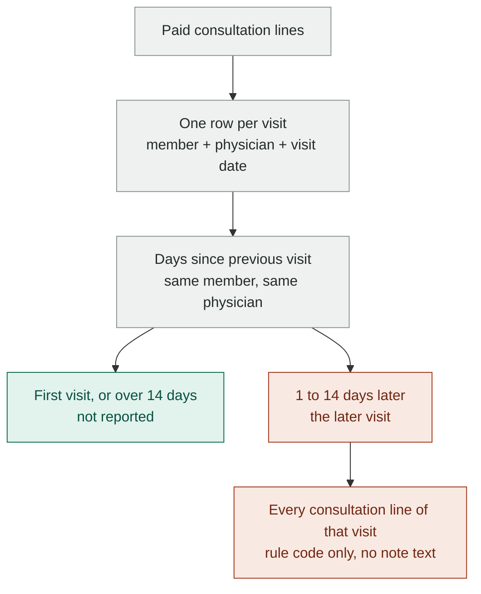

[Back to the rule index](#rule-index)

## S3 Service Frequency Breach

A service repeated sooner than the frequency SBS sets for its NPHIES code, counted across providers.

| | |
|---|---|
| **Level** | Service line |
| **Key settings** | Gap must be at least 1 day (same-day repeats are S1). |
| **Reference data** | SBS: freq |

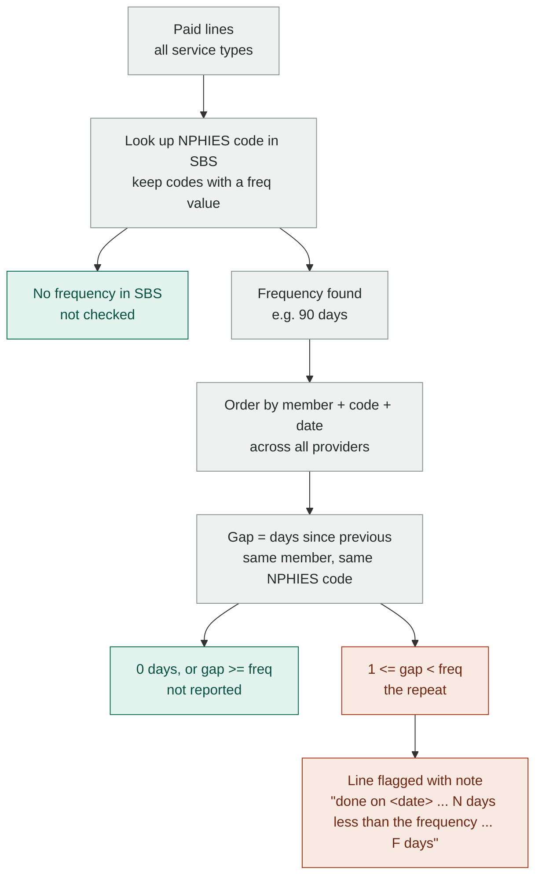

[Back to the rule index](#rule-index)

## S4 Excessive Radiology

More than 3 radiology studies for the same patient in a rolling 14 days.

| | |
|---|---|
| **Level** | Service line |
| **Key settings** | Window is inclusive and rolls with each study. |
| **Reference data** | None |

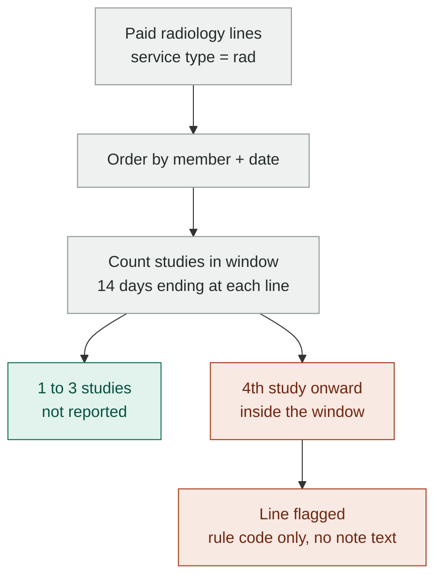

[Back to the rule index](#rule-index)

## S5 Exceeds Maximum Daily Limit

A line billed with a quantity greater than the daily limit SBS sets for its NPHIES code.

| | |
|---|---|
| **Level** | Service line |
| **Key settings** | Lines S1 already reported are skipped, so a line is never reported under both. |
| **Reference data** | SBS: daily_limit |

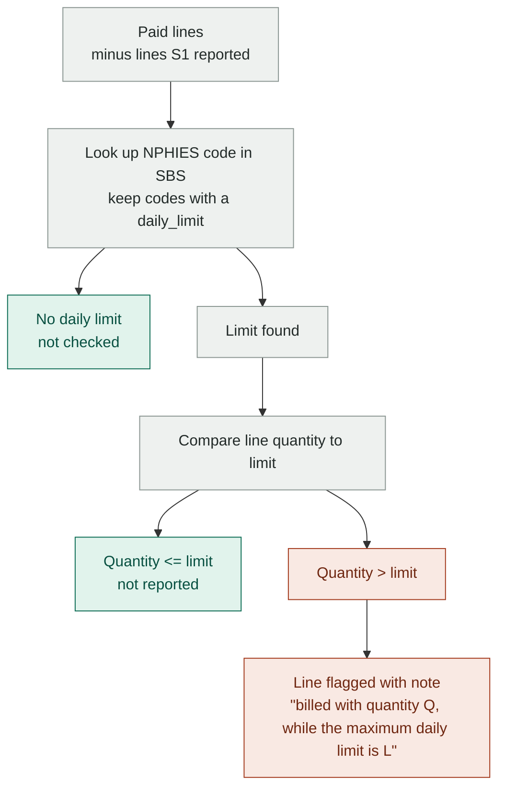

[Back to the rule index](#rule-index)

## S6 Unreasonable Quantity

A drug line billed with a quantity above 5.

| | |
|---|---|
| **Level** | Service line |
| **Key settings** | Drugs only. Other types are judged by S5 against SBS. Independent of S1 and S5. |
| **Reference data** | None |

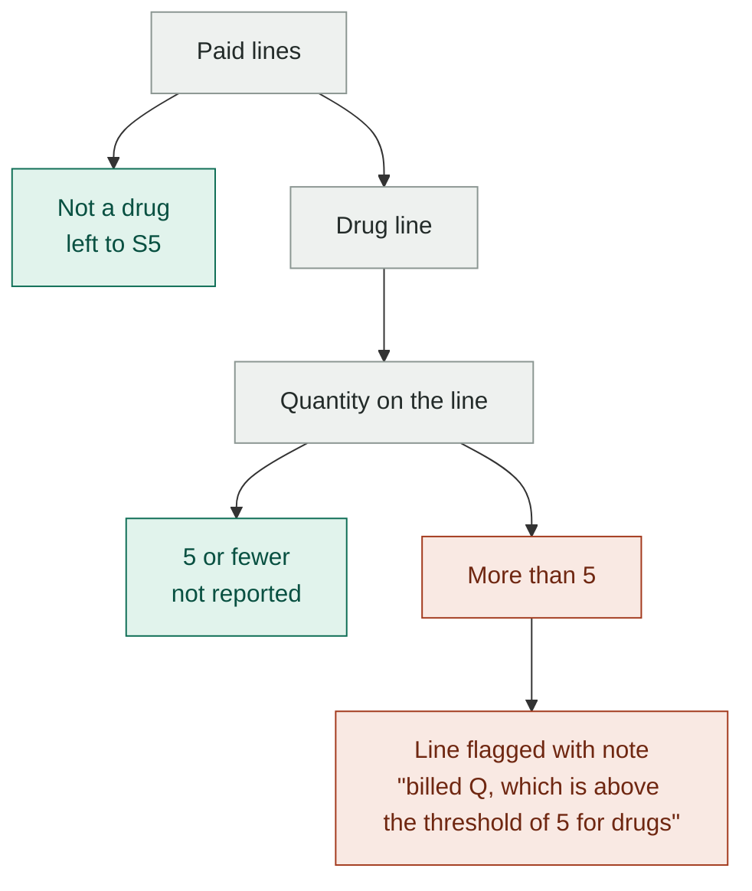

[Back to the rule index](#rule-index)

## S7 Duplicated Service Within 7 Days

The same service for the same patient at the same provider repeated 1 to 7 days later.

| | |
|---|---|
| **Level** | Service line |
| **Key settings** | Consultation excluded (S2 owns it). Non-drug lines only where SBS sets no frequency (else S3 owns it). |
| **Reference data** | SBS: freq (to defer to S3) |

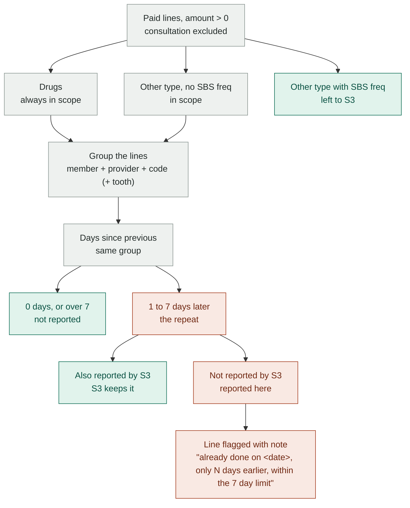

[Back to the rule index](#rule-index)

## S8 Diagnosis Outside Age Range

A diagnosis code billed for a patient whose age at the service date is outside the range ICD-10 allows.

| | |
|---|---|
| **Level** | Service line |
| **Key settings** | Both bounds inclusive. Age from DOB, else from the Age column; with Age only, a day limit fires only if broken across the whole year. |
| **Reference data** | ICD-10: AgeL, AgeH |

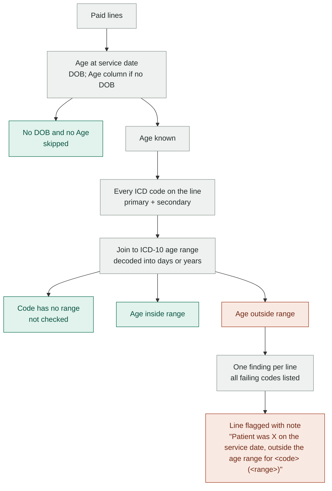

[Back to the rule index](#rule-index)

## S9 Diagnosis Gender Mismatch

A diagnosis code ICD-10 strictly restricts to one sex, billed for a patient of the other.

| | |
|---|---|
| **Level** | Service line |
| **Key settings** | Only Stype = 1 (strict). Stype 2 codes (rare but possible) are ignored. |
| **Reference data** | ICD-10: sex, Stype |

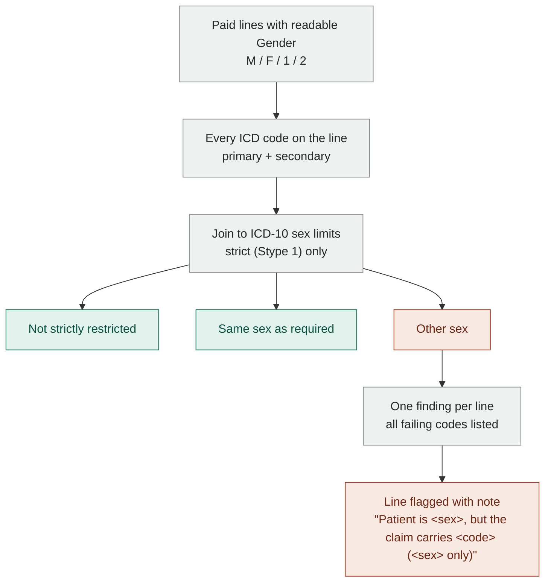

[Back to the rule index](#rule-index)

## S10 Isolated Consultation Visit

A claim billing nothing but consultation, with no test, medicine or procedure that followed.

| | |
|---|---|
| **Level** | Service line |
| **Key settings** | Cleared if the same patient and same physician have a non-consultation service on another claim the same day or up to 2 days later. |
| **Reference data** | None |

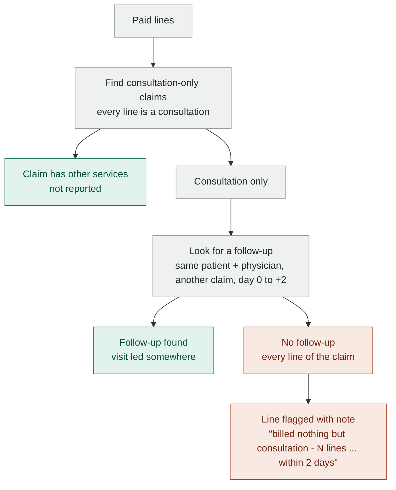

[Back to the rule index](#rule-index)

## S11 Excessive Consultation Frequency

A patient with more than 3 consultation-only claims inside a rolling 30 days.

| | |
|---|---|
| **Level** | Service line |
| **Key settings** | Counts claims, not lines. The window rolls rather than following calendar months. |
| **Reference data** | None |

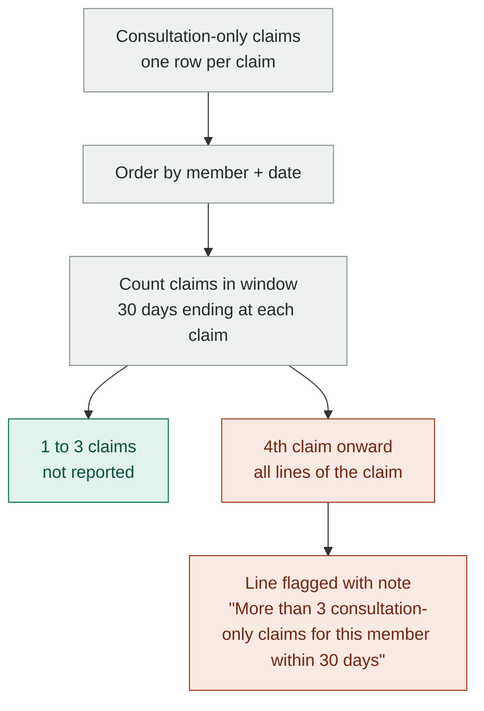

[Back to the rule index](#rule-index)

## S12 Invalid ICD-10 Code

A diagnosis code marked valid = 0 in ICD-10, or absent from the reference altogether.

| | |
|---|---|
| **Level** | Service line |
| **Key settings** | In practice it flags non-specific category codes (K29.7, J45, E11), not wrong ones. See the handover note. |
| **Reference data** | ICD-10: valid |

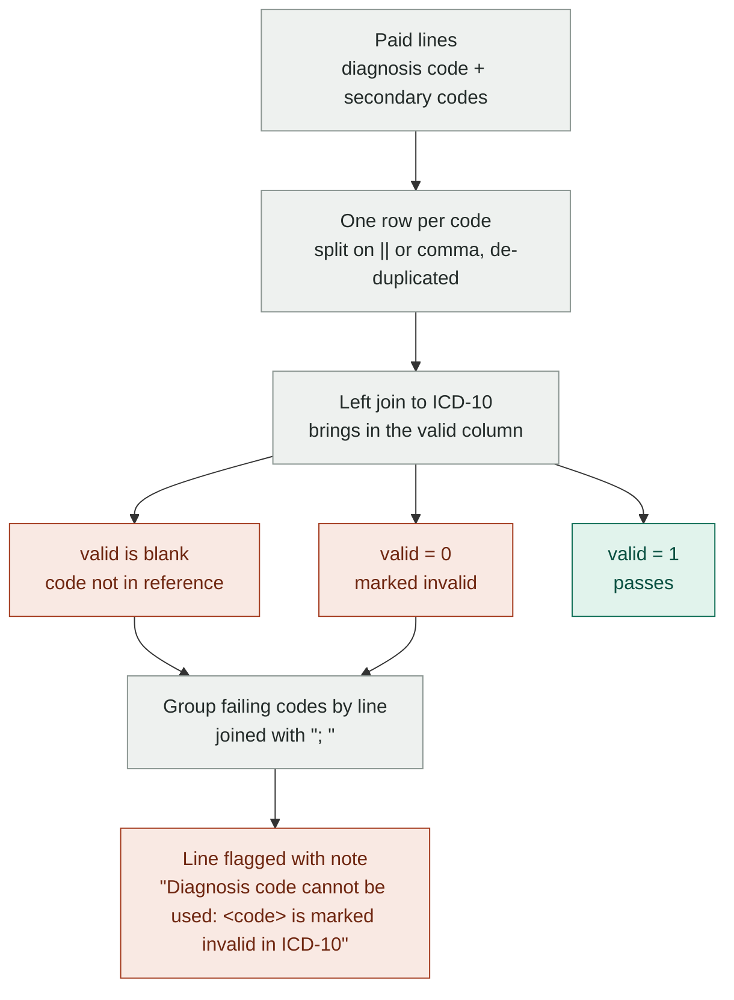

[Back to the rule index](#rule-index)

## S13 Inactive ICD-10 Code

A diagnosis code ICD-10 had withdrawn by the service date and not reactivated.

| | |
|---|---|
| **Level** | Service line |
| **Key settings** | Only codes with valid = 1; anything else is S12's finding. |
| **Reference data** | ICD-10: inactive, reactivated |

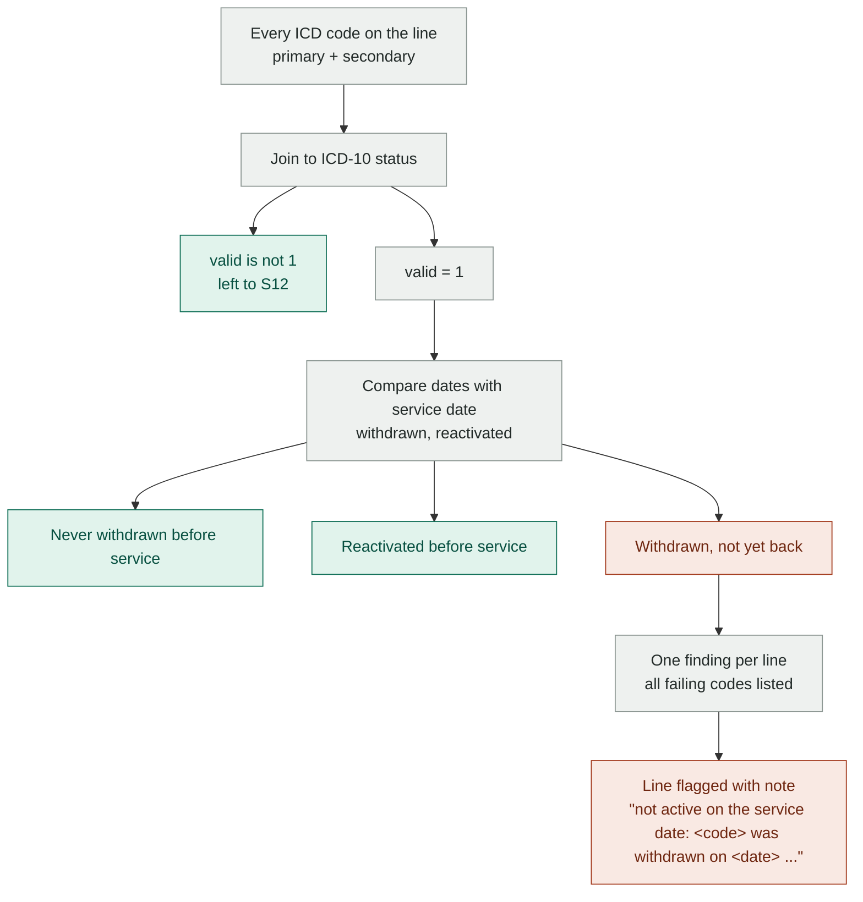

[Back to the rule index](#rule-index)

## S14 Not Valid Principal Diagnosis

A primary diagnosis that ICD-10 allows only as an additional diagnosis.

| | |
|---|---|
| **Level** | Service line |
| **Key settings** | Primary code only. Invalid or inactive codes are left to S12 and S13. |
| **Reference data** | ICD-10: UnacceptPDx |

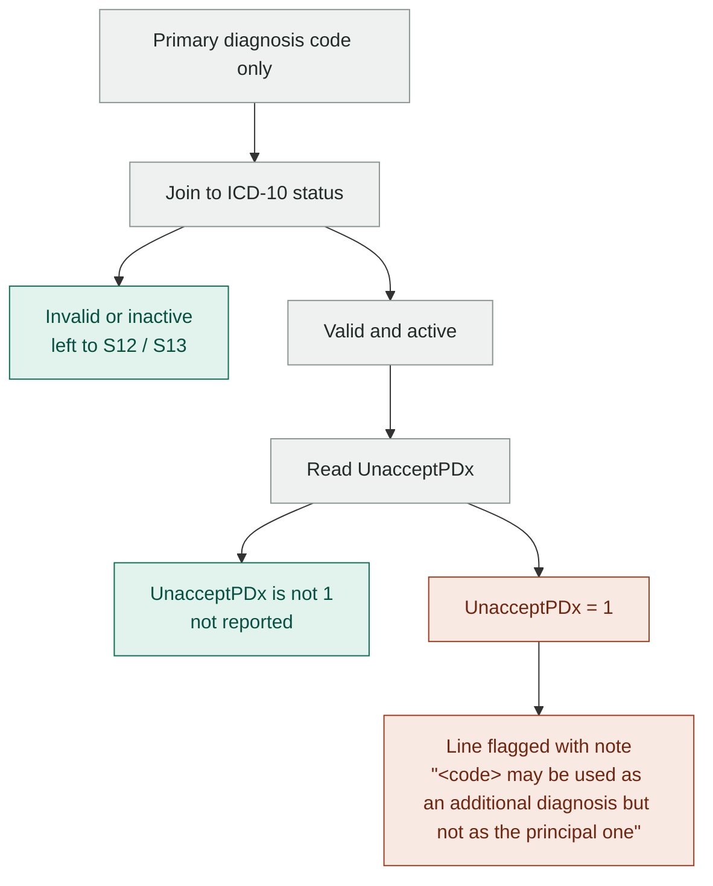

[Back to the rule index](#rule-index)

## S15 Service / Gender Mismatch

A service SBS restricts to one sex, billed for a patient of the other.

| | |
|---|---|
| **Level** | Service line |
| **Key settings** | Both strict (SType 1) and rare (SType 2) restrictions are reported; the note says which. |
| **Reference data** | SBS: Sex, SType |

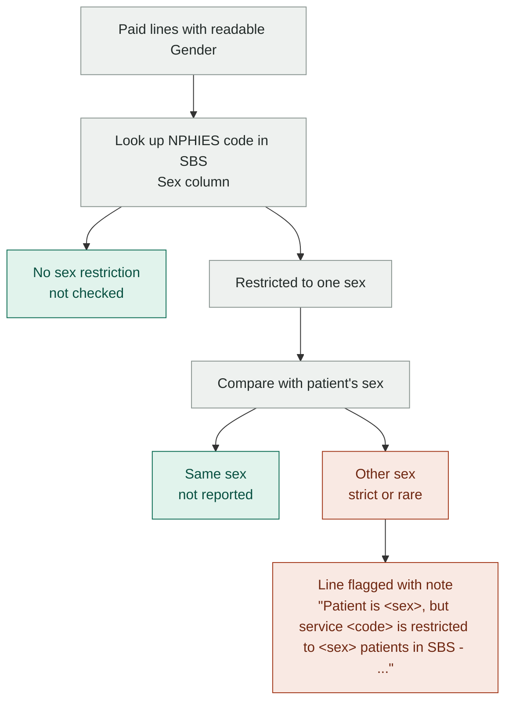

[Back to the rule index](#rule-index)

## S16 Service / Age Mismatch

A service billed for a patient outside the age range SBS allows it for.

| | |
|---|---|
| **Level** | Service line |
| **Key settings** | Age compared in the bound's own unit (days or years). Blank upper bound means no ceiling. |
| **Reference data** | SBS: AgeL, AgeH |

```mermaid
flowchart TB
    n0_0["Paid lines"]:::step
    n1_0["Age at service date<br/>DOB; Age column if no DOB"]:::step
    n2_0["No DOB and no Age<br/>skipped"]:::pass
    n2_1["Age known"]:::step
    n3_0["Look up NPHIES code in SBS<br/>AgeL / AgeH decoded"]:::step
    n4_0["No age restriction<br/>not checked"]:::pass
    n4_1["Age inside range"]:::pass
    n4_2["Age outside range"]:::flag
    n5_0["Line flagged with note<br/>#quot;Patient was X on the service date, but #lt;code#gt; is for patients A to B#quot;"]:::note
    n0_0 --> n1_0
    n1_0 --> n2_0
    n1_0 --> n2_1
    n2_1 --> n3_0
    n3_0 --> n4_0
    n3_0 --> n4_1
    n3_0 --> n4_2
    n4_2 --> n5_0
    classDef step fill:#eef1ef,stroke:#8b9692,color:#232b29
    classDef flag fill:#f9e9e3,stroke:#a33a1d,color:#6f2711
    classDef note fill:#f9e9e3,stroke:#a33a1d,color:#6f2711
    classDef pass fill:#e1f3ec,stroke:#0f6e56,color:#085041
    classDef other fill:#ffffff,stroke:#a9b3b0,color:#56635f,stroke-dasharray:4 3
```

[Back to the rule index](#rule-index)

## S17-1 Therapeutic Duplication, Same Active Ingredient

Two different drugs given to one patient on one day that share the ATC code to 7 characters (same active ingredient).

| | |
|---|---|
| **Level** | Service line |
| **Key settings** | Each pair is charged to its deepest matching level only. The same service code twice is left to S1. The cheapest line of a group is kept as the legitimate treatment. |
| **Reference data** | SFDA drug list: AtcCode1 (by RegisterNumber, then GTIN) |

```mermaid
flowchart TB
    n0_0["Paid drug lines"]:::step
    n1_0["Find each drug's ATC code<br/>Register number, then GTIN fallback"]:::step
    n2_0["No ATC code found<br/>not checked"]:::pass
    n2_1["ATC code found"]:::step
    n3_0["Pair drugs per patient-day<br/>2+ drugs; same service code left to S1"]:::step
    n4_0["Deepest shared ATC prefix<br/>no shared prefix: clean"]:::step
    n5_0["7 characters<br/>same active ingredient"]:::flag
    n5_1["5 characters<br/>same chemical subgroup, S17-2"]:::other
    n5_2["4 characters<br/>same pharmacological subgroup, S17-3"]:::other
    n6_0["Cheapest line in group<br/>kept"]:::pass
    n6_1["Dearer lines<br/>reported"]:::flag
    n7_0["Line flagged with note<br/>#quot;#lt;drug#gt; duplicates #lt;drug#gt; ... same active ingredient (#lt;ATC#gt;)#quot;"]:::note
    n0_0 --> n1_0
    n1_0 --> n2_0
    n1_0 --> n2_1
    n2_1 --> n3_0
    n3_0 --> n4_0
    n4_0 --> n5_0
    n4_0 --> n5_1
    n4_0 --> n5_2
    n5_0 --> n6_0
    n5_0 --> n6_1
    n6_1 --> n7_0
    classDef step fill:#eef1ef,stroke:#8b9692,color:#232b29
    classDef flag fill:#f9e9e3,stroke:#a33a1d,color:#6f2711
    classDef note fill:#f9e9e3,stroke:#a33a1d,color:#6f2711
    classDef pass fill:#e1f3ec,stroke:#0f6e56,color:#085041
    classDef other fill:#ffffff,stroke:#a9b3b0,color:#56635f,stroke-dasharray:4 3
```

[Back to the rule index](#rule-index)

## S17-2 Therapeutic Duplication, Same Chemical Subgroup

Two different drugs given to one patient on one day that share the ATC code to 5 characters (same chemical subgroup).

| | |
|---|---|
| **Level** | Service line |
| **Key settings** | Each pair is charged to its deepest matching level only. The same service code twice is left to S1. The cheapest line of a group is kept as the legitimate treatment. |
| **Reference data** | SFDA drug list: AtcCode1 (by RegisterNumber, then GTIN) |

```mermaid
flowchart TB
    n0_0["Paid drug lines"]:::step
    n1_0["Find each drug's ATC code<br/>Register number, then GTIN fallback"]:::step
    n2_0["No ATC code found<br/>not checked"]:::pass
    n2_1["ATC code found"]:::step
    n3_0["Pair drugs per patient-day<br/>2+ drugs; same service code left to S1"]:::step
    n4_0["Deepest shared ATC prefix<br/>no shared prefix: clean"]:::step
    n5_0["7 characters<br/>same active ingredient, S17-1"]:::other
    n5_1["5 characters<br/>same chemical subgroup"]:::flag
    n5_2["4 characters<br/>same pharmacological subgroup, S17-3"]:::other
    n6_0["Cheapest line in group<br/>kept"]:::pass
    n6_1["Dearer lines<br/>reported"]:::flag
    n7_0["Line flagged with note<br/>#quot;#lt;drug#gt; duplicates #lt;drug#gt; ... same chemical subgroup (#lt;ATC#gt;)#quot;"]:::note
    n0_0 --> n1_0
    n1_0 --> n2_0
    n1_0 --> n2_1
    n2_1 --> n3_0
    n3_0 --> n4_0
    n4_0 --> n5_0
    n4_0 --> n5_1
    n4_0 --> n5_2
    n5_1 --> n6_0
    n5_1 --> n6_1
    n6_1 --> n7_0
    classDef step fill:#eef1ef,stroke:#8b9692,color:#232b29
    classDef flag fill:#f9e9e3,stroke:#a33a1d,color:#6f2711
    classDef note fill:#f9e9e3,stroke:#a33a1d,color:#6f2711
    classDef pass fill:#e1f3ec,stroke:#0f6e56,color:#085041
    classDef other fill:#ffffff,stroke:#a9b3b0,color:#56635f,stroke-dasharray:4 3
```

[Back to the rule index](#rule-index)

## S17-3 Therapeutic Duplication, Same Pharmacological Subgroup

Two different drugs given to one patient on one day that share the ATC code to 4 characters (same pharmacological subgroup).

| | |
|---|---|
| **Level** | Service line |
| **Key settings** | Each pair is charged to its deepest matching level only. The same service code twice is left to S1. The cheapest line of a group is kept as the legitimate treatment. |
| **Reference data** | SFDA drug list: AtcCode1 (by RegisterNumber, then GTIN) |

```mermaid
flowchart TB
    n0_0["Paid drug lines"]:::step
    n1_0["Find each drug's ATC code<br/>Register number, then GTIN fallback"]:::step
    n2_0["No ATC code found<br/>not checked"]:::pass
    n2_1["ATC code found"]:::step
    n3_0["Pair drugs per patient-day<br/>2+ drugs; same service code left to S1"]:::step
    n4_0["Deepest shared ATC prefix<br/>no shared prefix: clean"]:::step
    n5_0["7 characters<br/>same active ingredient, S17-1"]:::other
    n5_1["5 characters<br/>same chemical subgroup, S17-2"]:::other
    n5_2["4 characters<br/>same pharmacological subgroup"]:::flag
    n6_0["Cheapest line in group<br/>kept"]:::pass
    n6_1["Dearer lines<br/>reported"]:::flag
    n7_0["Line flagged with note<br/>#quot;#lt;drug#gt; duplicates #lt;drug#gt; ... same pharmacological subgroup (#lt;ATC#gt;)#quot;"]:::note
    n0_0 --> n1_0
    n1_0 --> n2_0
    n1_0 --> n2_1
    n2_1 --> n3_0
    n3_0 --> n4_0
    n4_0 --> n5_0
    n4_0 --> n5_1
    n4_0 --> n5_2
    n5_2 --> n6_0
    n5_2 --> n6_1
    n6_1 --> n7_0
    classDef step fill:#eef1ef,stroke:#8b9692,color:#232b29
    classDef flag fill:#f9e9e3,stroke:#a33a1d,color:#6f2711
    classDef note fill:#f9e9e3,stroke:#a33a1d,color:#6f2711
    classDef pass fill:#e1f3ec,stroke:#0f6e56,color:#085041
    classDef other fill:#ffffff,stroke:#a9b3b0,color:#56635f,stroke-dasharray:4 3
```

[Back to the rule index](#rule-index)

## S18-1 More Than 5% Unlisted SBS Codes

Every unlisted service from a provider whose unlisted share of non-drug lines is 5% or more.

| | |
|---|---|
| **Level** | Service line |
| **Key settings** | Share counted per billed line, not per distinct code. A code missing from the reference counts in the total but never as unlisted. |
| **Reference data** | SBS: Unlisted |

```mermaid
flowchart TB
    n0_0["Paid non-drug lines"]:::step
    n1_0["Read the Unlisted flag<br/>SBS"]:::step
    n2_0["Provider's unlisted share<br/>unlisted lines / all lines"]:::step
    n3_0["Below 5%<br/>nothing reported"]:::pass
    n3_1["5% or more"]:::step
    n4_0["Listed lines<br/>not reported"]:::pass
    n4_1["Unlisted lines<br/>every one reported"]:::flag
    n5_0["Line flagged with note<br/>#quot;This service is unlisted, and #lt;provider#gt; billed N ... - x%, at or above the 5% limit#quot;"]:::note
    n0_0 --> n1_0
    n1_0 --> n2_0
    n2_0 --> n3_0
    n2_0 --> n3_1
    n3_1 --> n4_0
    n3_1 --> n4_1
    n4_1 --> n5_0
    classDef step fill:#eef1ef,stroke:#8b9692,color:#232b29
    classDef flag fill:#f9e9e3,stroke:#a33a1d,color:#6f2711
    classDef note fill:#f9e9e3,stroke:#a33a1d,color:#6f2711
    classDef pass fill:#e1f3ec,stroke:#0f6e56,color:#085041
    classDef other fill:#ffffff,stroke:#a9b3b0,color:#56635f,stroke-dasharray:4 3
```

[Back to the rule index](#rule-index)

## S18-2 More Than 3% Unlisted Drugs

Every unlisted drug from a provider whose unlisted share of drug lines is 3% or more.

| | |
|---|---|
| **Level** | Service line |
| **Key settings** | Share counted per billed line, not per distinct code. A code missing from the reference counts in the total but never as unlisted. |
| **Reference data** | NPHIES GTIN list: Unlisted |

```mermaid
flowchart TB
    n0_0["Paid drug lines"]:::step
    n1_0["Read the Unlisted flag<br/>NPHIES GTIN list"]:::step
    n2_0["Provider's unlisted share<br/>unlisted lines / all lines"]:::step
    n3_0["Below 3%<br/>nothing reported"]:::pass
    n3_1["3% or more"]:::step
    n4_0["Listed lines<br/>not reported"]:::pass
    n4_1["Unlisted lines<br/>every one reported"]:::flag
    n5_0["Line flagged with note<br/>#quot;This drug is unlisted, and #lt;provider#gt; billed N ... - x%, at or above the 3% limit#quot;"]:::note
    n0_0 --> n1_0
    n1_0 --> n2_0
    n2_0 --> n3_0
    n2_0 --> n3_1
    n3_1 --> n4_0
    n3_1 --> n4_1
    n4_1 --> n5_0
    classDef step fill:#eef1ef,stroke:#8b9692,color:#232b29
    classDef flag fill:#f9e9e3,stroke:#a33a1d,color:#6f2711
    classDef note fill:#f9e9e3,stroke:#a33a1d,color:#6f2711
    classDef pass fill:#e1f3ec,stroke:#0f6e56,color:#085041
    classDef other fill:#ffffff,stroke:#a9b3b0,color:#56635f,stroke-dasharray:4 3
```

[Back to the rule index](#rule-index)

## S19-1 Service Too Frequent Use, Provider Level

A service or drug that appears on more than 70% of a provider's claims, consultation excluded.

| | |
|---|---|
| **Level** | Service line |
| **Key settings** | Counted by distinct claim ID. An unlisted, placeholder or blank NPHIES code is judged by the line's service code instead. Exactly 70% does not fire. |
| **Reference data** | SBS and NPHIES GTIN: Unlisted (to spot non-specific codes) |

```mermaid
flowchart TB
    n0_0["Paid lines, consultation removed<br/>grouped by provider ID"]:::step
    n1_0["Identify the item<br/>NPHIES code, or service code if unlisted"]:::step
    n2_0["Share per provider<br/>claims with item / all provider claims"]:::step
    n3_0["70% or less<br/>not reported"]:::pass
    n3_1["Above 70%<br/>every line of the item"]:::flag
    n4_0["Every line of that item flagged<br/>#quot;#lt;item#gt; appears on N of #lt;provider#gt;'s M claims ... above the 70% limit#quot;"]:::note
    n0_0 --> n1_0
    n1_0 --> n2_0
    n2_0 --> n3_0
    n2_0 --> n3_1
    n3_1 --> n4_0
    classDef step fill:#eef1ef,stroke:#8b9692,color:#232b29
    classDef flag fill:#f9e9e3,stroke:#a33a1d,color:#6f2711
    classDef note fill:#f9e9e3,stroke:#a33a1d,color:#6f2711
    classDef pass fill:#e1f3ec,stroke:#0f6e56,color:#085041
    classDef other fill:#ffffff,stroke:#a9b3b0,color:#56635f,stroke-dasharray:4 3
```

[Back to the rule index](#rule-index)

## S19-2 Service Too Frequent Use, Physician Level

A service or drug that appears on more than 70% of a physician's claims, consultation excluded.

| | |
|---|---|
| **Level** | Service line |
| **Key settings** | Counted by distinct claim ID. An unlisted, placeholder or blank NPHIES code is judged by the line's service code instead. Exactly 70% does not fire. Only physicians with more than 10 claims are judged. |
| **Reference data** | SBS and NPHIES GTIN: Unlisted (to spot non-specific codes) |

```mermaid
flowchart TB
    n0_0["Paid lines, consultation removed<br/>blank physician names skipped"]:::step
    n1_0["Identify the item<br/>NPHIES code, or service code if unlisted"]:::step
    n2_0["Share per physician<br/>claims with item / all physician claims"]:::step
    n3_0["10 claims or fewer<br/>physician not judged"]:::pass
    n3_1["70% or less<br/>not reported"]:::pass
    n3_2["Above 70%<br/>every line of the item"]:::flag
    n4_0["Every line of that item flagged<br/>#quot;#lt;item#gt; appears on N of #lt;physician#gt;'s M claims ... above the 70% limit#quot;"]:::note
    n0_0 --> n1_0
    n1_0 --> n2_0
    n2_0 --> n3_0
    n2_0 --> n3_1
    n2_0 --> n3_2
    n3_2 --> n4_0
    classDef step fill:#eef1ef,stroke:#8b9692,color:#232b29
    classDef flag fill:#f9e9e3,stroke:#a33a1d,color:#6f2711
    classDef note fill:#f9e9e3,stroke:#a33a1d,color:#6f2711
    classDef pass fill:#e1f3ec,stroke:#0f6e56,color:#085041
    classDef other fill:#ffffff,stroke:#a9b3b0,color:#56635f,stroke-dasharray:4 3
```

[Back to the rule index](#rule-index)

## S20-1 Phantom Billing

A paid line on a claim whose chief complaint says the visit was cancelled or the patient not seen.

| | |
|---|---|
| **Level** | Service line |
| **Key settings** | Whole words, anywhere in the complaint, case-insensitive. "not seen" counts only as the entire complaint. |
| **Reference data** | Word list in code (S20_PHANTOM_WORDS) |

```mermaid
flowchart TB
    n0_0["Paid lines<br/>chief complaint per claim"]:::step
    n1_0["Normalise the complaint<br/>trim spaces, lower-case"]:::step
    n2_0["Search the word list<br/>cancel, cancelled, wrong entry, pt not seen ..."]:::step
    n3_0["No match<br/>not reported"]:::pass
    n3_1["Match found<br/>every paid line on the claim"]:::flag
    n4_0["Line flagged with note<br/>#quot;The chief complaint says '#lt;word#gt;'#quot;"]:::note
    n0_0 --> n1_0
    n1_0 --> n2_0
    n2_0 --> n3_0
    n2_0 --> n3_1
    n3_1 --> n4_0
    classDef step fill:#eef1ef,stroke:#8b9692,color:#232b29
    classDef flag fill:#f9e9e3,stroke:#a33a1d,color:#6f2711
    classDef note fill:#f9e9e3,stroke:#a33a1d,color:#6f2711
    classDef pass fill:#e1f3ec,stroke:#0f6e56,color:#085041
    classDef other fill:#ffffff,stroke:#a9b3b0,color:#56635f,stroke-dasharray:4 3
```

[Back to the rule index](#rule-index)

## S20-2 Missed Chief Complaint

A paid line on a claim with no chief complaint, or one holding no real word.

| | |
|---|---|
| **Level** | Service line |
| **Key settings** | A real word is any run of 2+ letters (Latin or Arabic), so "htn" passes and "0", ".", "s" do not. If the file has no complaint column at all, the rule stays silent. |
| **Reference data** | None |

```mermaid
flowchart TB
    n0_0["Paid lines<br/>file must carry a chief complaint"]:::step
    n1_0["Normalise the complaint<br/>trim spaces, lower-case"]:::step
    n2_0["Has a real word<br/>2+ letters in a row"]:::pass
    n2_1["Blank"]:::flag
    n2_2["No real word<br/>e.g. #quot;0#quot;, #quot;.#quot;, #quot;s#quot;"]:::flag
    n3_0["Note<br/>#quot;No chief complaint is recorded for this claim#quot;"]:::note
    n3_1["Note<br/>#quot;The chief complaint holds no real word: ...#quot;"]:::note
    n0_0 --> n1_0
    n1_0 --> n2_0
    n1_0 --> n2_1
    n1_0 --> n2_2
    n2_1 --> n3_0
    n2_2 --> n3_1
    classDef step fill:#eef1ef,stroke:#8b9692,color:#232b29
    classDef flag fill:#f9e9e3,stroke:#a33a1d,color:#6f2711
    classDef note fill:#f9e9e3,stroke:#a33a1d,color:#6f2711
    classDef pass fill:#e1f3ec,stroke:#0f6e56,color:#085041
    classDef other fill:#ffffff,stroke:#a9b3b0,color:#56635f,stroke-dasharray:4 3
```

[Back to the rule index](#rule-index)

## S21 Service Outside Coverage

A service dated before the policy start date or after the policy end date.

| | |
|---|---|
| **Level** | Service line |
| **Key settings** | Both end days count as covered. Compared as whole days. |
| **Reference data** | Claims file: PolicyInception, PolicyExpiry |

```mermaid
flowchart TB
    n0_0["Paid lines<br/>policy start, end and service date"]:::step
    n1_0["A date is missing<br/>not judged"]:::pass
    n1_1["All three dates present"]:::step
    n2_0["Compare service date<br/>with the coverage period"]:::step
    n3_0["Before start date"]:::flag
    n3_1["Start to end<br/>covered, inclusive"]:::pass
    n3_2["After end date"]:::flag
    n4_0["Line flagged with note<br/>#quot;Service date D is before/after the policy ... N day(s) outside coverage#quot;"]:::note
    n0_0 --> n1_0
    n0_0 --> n1_1
    n1_1 --> n2_0
    n2_0 --> n3_0
    n2_0 --> n3_1
    n2_0 --> n3_2
    n3_0 --> n4_0
    n3_2 --> n4_0
    classDef step fill:#eef1ef,stroke:#8b9692,color:#232b29
    classDef flag fill:#f9e9e3,stroke:#a33a1d,color:#6f2711
    classDef note fill:#f9e9e3,stroke:#a33a1d,color:#6f2711
    classDef pass fill:#e1f3ec,stroke:#0f6e56,color:#085041
    classDef other fill:#ffffff,stroke:#a9b3b0,color:#56635f,stroke-dasharray:4 3
```

[Back to the rule index](#rule-index)

## S22 Excessive Member Visits

A patient with more than 5 visit days inside a rolling 30 days, counted across every provider and service type.

| | |
|---|---|
| **Level** | Service line |
| **Key settings** | A visit day is one patient on one date; same-day claims count once. The window is that day and the 29 before it. Threshold set from the data with Tukey's outlier fences. Treatment courses (dressings, injections, physiotherapy) are not excluded. Lines S2 or S11 already reported are skipped, but still count as visits. |
| **Reference data** | None |

```mermaid
flowchart TB
    n0_0["Paid lines<br/>all providers, all service types"]:::step
    n1_0["One row per visit day<br/>patient + date; same-day claims count once"]:::step
    n2_0["Count the visit days in the window<br/>this day and the 29 days before it"]:::step
    n3_0["5 or fewer<br/>not reported"]:::pass
    n3_1["More than 5<br/>every paid line that day"]:::flag
    n4_0["Already reported by S2 or S11<br/>not reported again"]:::other
    n4_1["Line flagged with note<br/>#quot;6th visit day in 30 days for this patient (#lt;from#gt; to #lt;date#gt;), at N provider(s)#quot;"]:::note
    n0_0 --> n1_0
    n1_0 --> n2_0
    n2_0 --> n3_0
    n2_0 --> n3_1
    n3_1 --> n4_0
    n3_1 --> n4_1
    classDef step fill:#eef1ef,stroke:#8b9692,color:#232b29
    classDef flag fill:#f9e9e3,stroke:#a33a1d,color:#6f2711
    classDef note fill:#f9e9e3,stroke:#a33a1d,color:#6f2711
    classDef pass fill:#e1f3ec,stroke:#0f6e56,color:#085041
    classDef other fill:#ffffff,stroke:#a9b3b0,color:#56635f,stroke-dasharray:4 3
```

[Back to the rule index](#rule-index)

---

<sub>A portfolio project. The rules, diagrams and wording describe the engine's logic only; no claims data is shown on this page.</sub>
