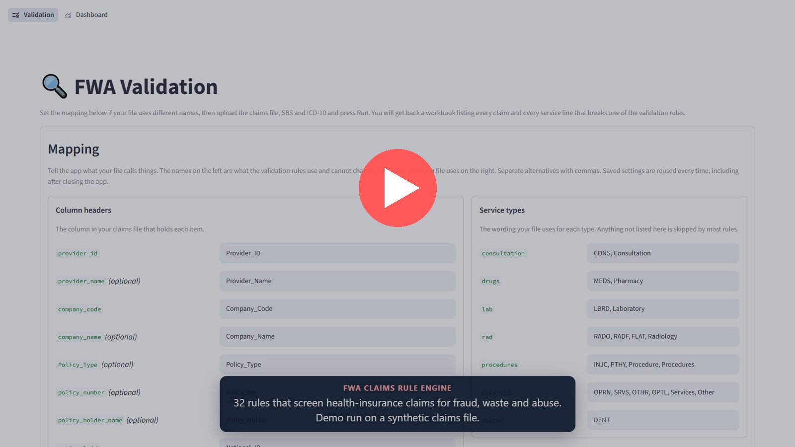

# FWA Claims Rule Engine

*Portfolio project · Healthcare claims automation*

A rule engine that screens health-insurance claims for fraud, waste and abuse. 32 rules check every claim and service line, explain each finding, and work with any claims export layout.

Built on Saudi standards (NPHIES SBS, ICD-10, SFDA, GTIN); the code lists can be swapped for CPT, HCPCS, ICD-10-CM or NDC.

| 📋 **32 validation rules** Run over every claim and service line | 🧾 **5 claim-level rules** Judge whole claims: duplicates, clones, capacity |
|---|---|
| 🔍 **27 service-line rules** Judge each line: coding, frequency, pharmacy | 📂 **Any layout, any size** Export columns mapped once and remembered |

**[👉 Open the rule flowcharts](FLOWCHARTS.md)**

## The problem

Claim audit is mostly manual: reviewers sample claims and hunt for the same patterns, such as duplicate services, diagnoses that don't fit the patient's age or sex, cloned claims, duplicate drugs, or visits after a policy expired. Each check is simple; running all of them on every line is not.

This engine turns those checks into documented rules that run on the whole file in one pass.

## How it works

1. **Map the export.** Headers are matched once to a 60-column template and remembered.
2. **Load the standards.** SBS, ICD-10, SFDA and GTIN lists are stored and reused.
3. **Run the rules.** Unpaid lines are set aside; claim and service-line rules run in a fixed order.
4. **Deliver the findings.** An Excel workbook with a reason next to every flagged line.
5. **Track it on the dashboard.** Findings turned into money and trends by rule and provider.

> **Why the dashboard matters**
>
> The findings list says what's wrong; the dashboard says where to act first.
>
> - **Headline cards**: paid vs rejected amount and the rejection rate, each line counted once.
> - **Trends**: billed and rejected amounts per provider over time.
> - **By rule**: which rules carry the rejected money.
> - **Provider behaviour**: unlisted-code shares and over-used services.
> - **Filters**: provider, period and service type.

## See it in action

*Screens from the app, run on a synthetic claims file. All patients, physicians, providers and claims are invented.*

▶ Demo: the app running end to end, one minute (click to open)

### Run screen

Upload the claims file and choose the results layout.

### Column converter

Map the file's headers and service types once; they're reused every run.

### Results

Total claims and service lines, then a count per rule.

### What the reviewer gets

Two layouts: **one row per finding**, or **one row per line** with a column for every rule plus a count and the names of the rules each line broke. Below, a slice of the demo workbook (14,732 lines, 97 columns).

### Dashboard: overview

Filters and paid vs rejected totals.

### Dashboard: trend by provider

Billed amount per provider over time.

### Dashboard: where the money is

Rejected amount by rule.

### Dashboard: provider behaviour

Each provider's unlisted-code share against the S18 limits.

### Dashboard: physician pattern

Services each physician attaches to over 70% of their claims (rule S19-2).

## The 32 rules

Each rule has a flowchart and a note template, so every finding says why it was raised.

**[👉 Open the rule flowcharts](FLOWCHARTS.md)**

### Claim level · 5 rules

| Code | Rule | What it catches |
|---|---|---|
| [`C1`](FLOWCHARTS.md#c1-duplicate-claim) | Duplicate Claim | Two or more claims for the same patient on the same day billing exactly the same set of services. |
| [`C2`](FLOWCHARTS.md#c2-member-treated-at-multiple-providers-same-day) | Member Treated at Multiple Providers, Same Day | A patient with paid consultation lines at two or more different providers on one day. |
| [`C3`](FLOWCHARTS.md#c3-cloned-claims) | Cloned Claims | The same provider, anywhere in the file, billing an identical set of services, principal diagnoses and chief complaint for different patients. |
| [`C4-1`](FLOWCHARTS.md#c4-1-physician-daily-capacity-breach-doubtful) | Physician Daily Capacity Breach (doubtful) | A physician seeing more than 40 different patients in consultation on one day. |
| [`C4-2`](FLOWCHARTS.md#c4-2-physician-daily-capacity-breach-confirmed) | Physician Daily Capacity Breach (confirmed) | A physician seeing 60 or more different patients in consultation on one day. |

### Duplication and frequency · 9 rules

| Code | Rule | What it catches |
|---|---|---|
| [`S1`](FLOWCHARTS.md#s1-duplicate-service) | Duplicate Service | The same service billed more than once for the same patient on the same day. |
| [`S2`](FLOWCHARTS.md#s2-repeat-consultation-within-14-days) | Repeat Consultation Within 14 Days | The same patient seen again by the same physician 1 to 14 days after the previous visit. |
| [`S3`](FLOWCHARTS.md#s3-service-frequency-breach) | Service Frequency Breach | A service repeated sooner than the frequency SBS sets for its NPHIES code, counted across providers. |
| [`S4`](FLOWCHARTS.md#s4-excessive-radiology) | Excessive Radiology | More than 3 radiology studies for the same patient in a rolling 14 days. |
| [`S5`](FLOWCHARTS.md#s5-exceeds-maximum-daily-limit) | Exceeds Maximum Daily Limit | A line billed with a quantity greater than the daily limit SBS sets for its NPHIES code. |
| [`S6`](FLOWCHARTS.md#s6-unreasonable-quantity) | Unreasonable Quantity | A drug line billed with a quantity above 5. |
| [`S7`](FLOWCHARTS.md#s7-duplicated-service-within-7-days) | Duplicated Service Within 7 Days | The same service for the same patient at the same provider repeated 1 to 7 days later. |
| [`S11`](FLOWCHARTS.md#s11-excessive-consultation-frequency) | Excessive Consultation Frequency | A patient with more than 3 consultation-only claims inside a rolling 30 days. |
| [`S22`](FLOWCHARTS.md#s22-excessive-member-visits) | Excessive Member Visits | A patient with more than 5 visit days inside a rolling 30 days, counted across every provider and service type. |

### Coding validity · 7 rules

| Code | Rule | What it catches |
|---|---|---|
| [`S8`](FLOWCHARTS.md#s8-diagnosis-outside-age-range) | Diagnosis Outside Age Range | A diagnosis code billed for a patient whose age at the service date is outside the range ICD-10 allows. |
| [`S9`](FLOWCHARTS.md#s9-diagnosis-gender-mismatch) | Diagnosis Gender Mismatch | A diagnosis code ICD-10 strictly restricts to one sex, billed for a patient of the other. |
| [`S12`](FLOWCHARTS.md#s12-invalid-icd-10-code) | Invalid ICD-10 Code | A diagnosis code marked valid = 0 in ICD-10, or absent from the reference altogether. |
| [`S13`](FLOWCHARTS.md#s13-inactive-icd-10-code) | Inactive ICD-10 Code | A diagnosis code ICD-10 had withdrawn by the service date and not reactivated. |
| [`S14`](FLOWCHARTS.md#s14-not-valid-principal-diagnosis) | Not Valid Principal Diagnosis | A primary diagnosis that ICD-10 allows only as an additional diagnosis. |
| [`S15`](FLOWCHARTS.md#s15-service--gender-mismatch) | Service / Gender Mismatch | A service SBS restricts to one sex, billed for a patient of the other. |
| [`S16`](FLOWCHARTS.md#s16-service--age-mismatch) | Service / Age Mismatch | A service billed for a patient outside the age range SBS allows it for. |

### Pharmacy · 3 rules

| Code | Rule | What it catches |
|---|---|---|
| [`S17-1`](FLOWCHARTS.md#s17-1-therapeutic-duplication-same-active-ingredient) | Therapeutic Duplication, Same Active Ingredient | Two different drugs given to one patient on one day that share the ATC code to 7 characters (same active ingredient). |
| [`S17-2`](FLOWCHARTS.md#s17-2-therapeutic-duplication-same-chemical-subgroup) | Therapeutic Duplication, Same Chemical Subgroup | Two different drugs given to one patient on one day that share the ATC code to 5 characters (same chemical subgroup). |
| [`S17-3`](FLOWCHARTS.md#s17-3-therapeutic-duplication-same-pharmacological-subgroup) | Therapeutic Duplication, Same Pharmacological Subgroup | Two different drugs given to one patient on one day that share the ATC code to 4 characters (same pharmacological subgroup). |

### Provider and physician behaviour · 4 rules

| Code | Rule | What it catches |
|---|---|---|
| [`S18-1`](FLOWCHARTS.md#s18-1-more-than-5-unlisted-sbs-codes) | More Than 5% Unlisted SBS Codes | Every unlisted service from a provider whose unlisted share of non-drug lines is 5% or more. |
| [`S18-2`](FLOWCHARTS.md#s18-2-more-than-3-unlisted-drugs) | More Than 3% Unlisted Drugs | Every unlisted drug from a provider whose unlisted share of drug lines is 3% or more. |
| [`S19-1`](FLOWCHARTS.md#s19-1-service-too-frequent-use-provider-level) | Service Too Frequent Use, Provider Level | A service or drug that appears on more than 70% of a provider's claims, consultation excluded. |
| [`S19-2`](FLOWCHARTS.md#s19-2-service-too-frequent-use-physician-level) | Service Too Frequent Use, Physician Level | A service or drug that appears on more than 70% of a physician's claims, consultation excluded. |

### Documentation and coverage · 4 rules

| Code | Rule | What it catches |
|---|---|---|
| [`S10`](FLOWCHARTS.md#s10-isolated-consultation-visit) | Isolated Consultation Visit | A claim billing nothing but consultation, with no test, medicine or procedure that followed. |
| [`S20-1`](FLOWCHARTS.md#s20-1-phantom-billing) | Phantom Billing | A paid line on a claim whose chief complaint says the visit was cancelled or the patient not seen. |
| [`S20-2`](FLOWCHARTS.md#s20-2-missed-chief-complaint) | Missed Chief Complaint | A paid line on a claim with no chief complaint, or one holding no real word. |
| [`S21`](FLOWCHARTS.md#s21-service-outside-coverage) | Service Outside Coverage | A service dated before the policy start date or after the policy end date. |

## Built to fit any claims data

**Any layout**

- A 60-column template, mapped once to the file's own headers.
- Missing fields are created blank; rules that need them say so.
- Results keep the file's own header names.

**Any size**

- Rules work on whole columns, so there's no line limit.
- Results past Excel's row limit continue on a second sheet.
- Repeat runs load in seconds from a cached copy.

## How the rules were set and proven

- 📏 **Thresholds from the data.** Limits were measured, not guessed; the excessive-visits limit, for example, came from Tukey's outlier fences.
- 🎯 **Tested at the boundary.** Each rule is tested at its exact limit: quiet at the threshold, firing one past it.
- 🔁 **Checked against a recount.** Every new or changed rule is recounted independently, line by line, and the other rules confirmed unchanged.
- 📝 **Documented for review.** A reference workbook, a flowchart per rule, and a review page for stakeholder comments.

## My role and tools

I designed the rules, set and tested the thresholds, defined how findings are reported, and validated the results. Built in Python (pandas) with a Streamlit app, using AI-assisted development.

`Python` `pandas` `Streamlit` `Altair` `Excel` `NPHIES SBS` `ICD-10` `SFDA drug register` `GTIN`

---

Personal portfolio project. No real claims, patient or provider data is shown. The engine's source code is kept private; this repository holds the public write-up only.
