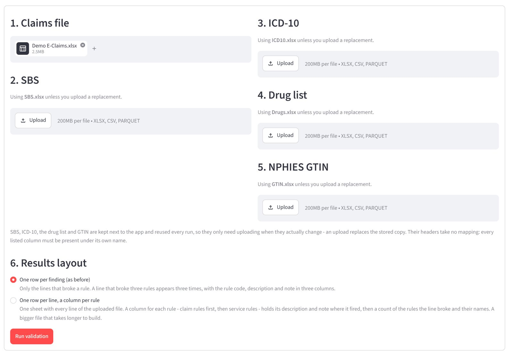
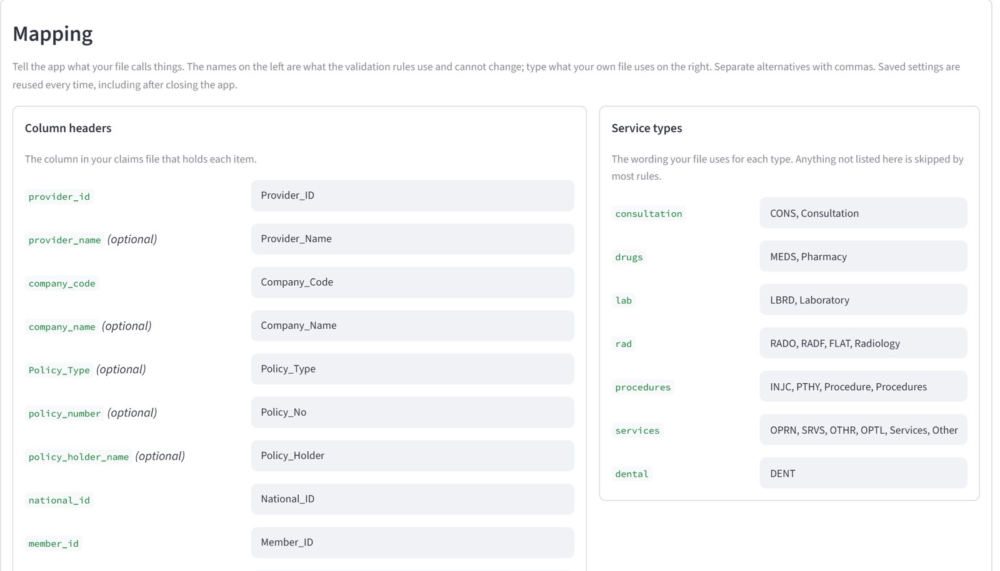
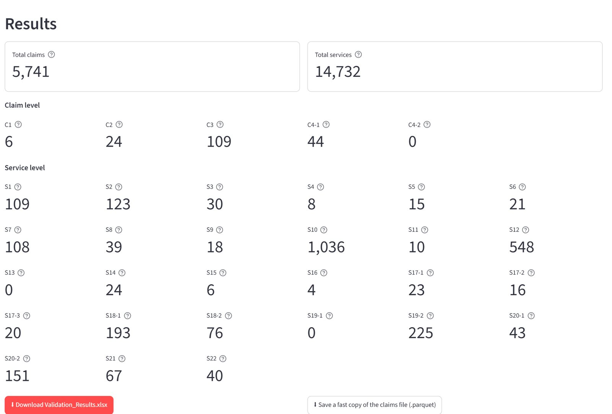
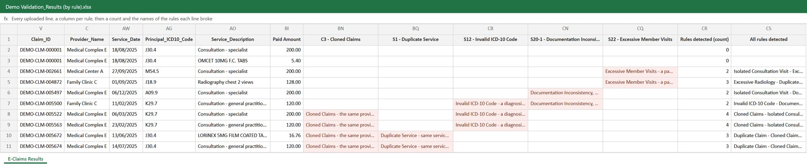
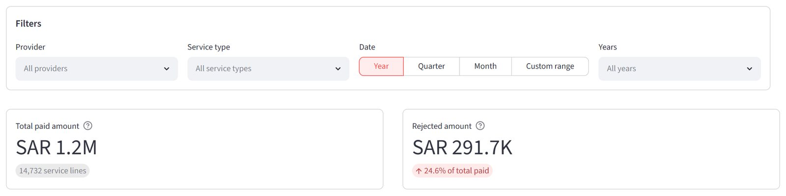
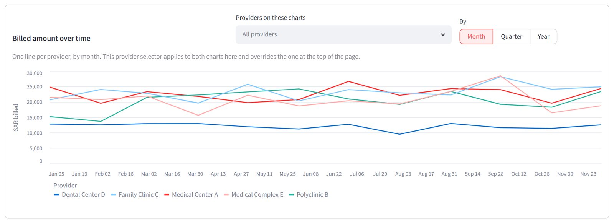
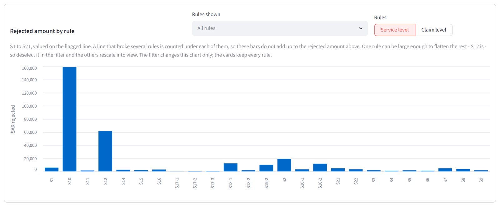
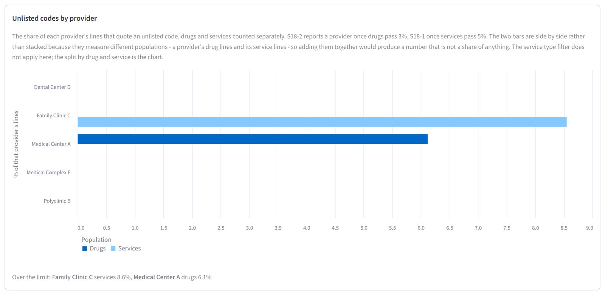
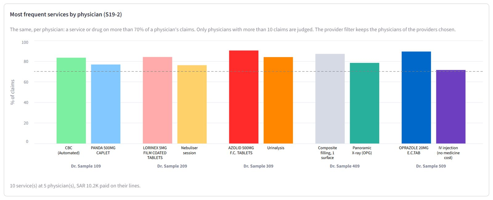

# FWA Claims Rule Engine

*Portfolio project · Healthcare claims automation*

A rule engine that screens health-insurance claim exports for fraud, waste and abuse. It runs
32 rules over every claim and service line, writes a reason next to each
finding, and adapts to whatever layout the claims export arrives in.

This example is built for the Saudi market, using NPHIES service codes (SBS), ICD-10, the SFDA
drug register and the NPHIES GTIN list. The rules are not tied to them: the code lists can be
swapped for other standards, such as CPT, HCPCS, ICD-10-CM or NDC drug codes.

**32** validation rules · **5** claim-level · **27** service-line level · **Any** export layout or file size

**[Case study website](https://omarzedan98.github.io/fwa-claims-rule-engine/)** · **[Flowchart for every rule](FLOWCHARTS.md)** ([web version](https://omarzedan98.github.io/fwa-claims-rule-engine/rule-flowcharts.html)) · **[PDF](FWA-Claims-Rule-Engine-Case-Study.pdf)** · **[Demo video, 1 min](https://omarzedan98.github.io/fwa-claims-rule-engine/FWA-Claims-Rule-Engine-Demo.mp4)**

## The problem

Medical claim audit is mostly manual. Reviewers sample claims and look for the same patterns again
and again: the same service billed twice, a diagnosis that cannot apply to the patient's age or sex,
one claim copied across many members, drugs that duplicate each other, a visit billed after the
policy expired. Each check is simple; doing all of them on every line of a large export is not.

This project turns those checks into explicit, documented rules that run on the whole file in one
pass, against the coding standards providers bill with: NPHIES service codes (SBS), ICD-10 diagnoses,
the SFDA drug register and the NPHIES GTIN list.

## How it works

1. **Map the export.** A column converter matches the file's headers to a 60-column claims
   template. Headers are mapped once in the app and remembered; older export spellings are
   recognised automatically. Service-type wording (CONS, MEDS, LBRD…) maps to seven types.
2. **Load the standards.** SBS, ICD-10, the SFDA drug list and the NPHIES GTIN list sit next to the
   app and are reused every run. Uploading a newer version replaces the stored copy.
3. **Run the rules.** Unpaid lines are set aside, then the claim-level rules and the service-line
   rules run in a fixed order, so a rule that depends on another always sees its result.
4. **Deliver the findings.** An Excel workbook with a reason written next to every flagged line, in
   the layout the reviewer chose before the run, ready to hand to the audit team.
5. **Track it on the dashboard.** Alongside the workbook, an interactive dashboard turns the
   findings into money and trends: billed against rejected amount, rejections by rule and provider,
   and how both move month by month.

> **Why the dashboard matters**
>
> A findings list says what is wrong; the dashboard says where to act first. It shows how much of
> what was paid the rules would reject, which providers and which rules drive that amount, and
> whether a pattern is growing or fading over time. That turns screening into something a manager
> can prioritise and report on: rejection rate, savings by rule, and providers to audit or educate.
>
> - **Headline cards**: total paid and rejected amount, with the rejection rate. A line that breaks
>   several rules is counted once, so the rejected amount is never inflated.
> - **Billed and rejected over time**: one line per provider, by month, quarter or year, to spot a
>   provider whose billing or rejections jump.
> - **Rejected amount by rule**: which rules carry the money, at claim or service level; any rule
>   can be hidden so the others rescale into view.
> - **Provider behaviour**: each provider's share of unlisted codes against its limit, and the
>   services a provider or physician attaches to most of their claims.
> - **Filters**: provider, period (year, quarter, month or a custom range) and service type,
>   applied across the page.

## See it in action

*Screens from the working app, run on a synthetic claims file built for this portfolio. Every
patient, physician, provider and claim in them is invented; only the medical and drug codes are
real public codes. A one-minute [demo video](https://omarzedan98.github.io/fwa-claims-rule-engine/FWA-Claims-Rule-Engine-Demo.mp4) shows the app running end to end.*

### Run screen

Upload the claims file; the four coding standards are stored and reused. The results layout is chosen before the run.

### Column converter

Each template field is mapped once to the file's own header, and the file's service-type wording to seven types. Saved and reused on every run.

### Results

What the run covered - total claims (distinct claim IDs) and total service lines - then a count for every rule, claim level and service level, and the workbook download.

### What the reviewer gets

Two download layouts. **One row per finding** lists each broken rule with its code, description and
note. **One row per line** keeps every line of the uploaded file and adds a column for every rule,
claim rules first, then a count and the names of every rule the line broke.

A slice of the real workbook from the demo run: 14,732 lines across 97 columns. The letters above
the headers are the columns' positions in the full sheet; rule cells hold the rule's description
and its note.

### Dashboard: overview

Filters for provider, period and service type; total paid against rejected, with the rejection rate.

### Dashboard: trend by provider

Billed amount per provider by month, quarter or year. A matching chart below it shows the rejected amount.

### Dashboard: where the money is

Rejected amount by rule, at service or claim level. Any rule can be hidden so the others rescale into view.

### Dashboard: provider behaviour

Each provider's share of unlisted codes, drugs and services separately, against the limits the S18 rules apply.

### Dashboard: physician pattern

Physicians attaching the same services or drugs to most of their claims - each doctor's items side by side, every bar above the 70% line of rule S19-2.

## The 32 rules

Grouped by what they look for. Each has a flowchart, a reference entry and a note template, so every
finding says why it was raised. **[See the flowchart for every rule →](FLOWCHARTS.md)**

### Claim level · 5 rules

| Code | Rule | What it catches |
|---|---|---|
| [`C1`](FLOWCHARTS.md#c1-duplicate-claim) | Duplicate Claim | Two or more claims for the same patient on the same day billing exactly the same set of services. |
| [`C2`](FLOWCHARTS.md#c2-member-treated-at-multiple-providers-same-day) | Member Treated at Multiple Providers, Same Day | A patient with paid consultation lines at two or more different providers on one day. |
| [`C3`](FLOWCHARTS.md#c3-cloned-claims) | Cloned Claims | The same provider, anywhere in the file, billing an identical set of services, principal diagnoses and chief complaint for different patients. |
| [`C4-1`](FLOWCHARTS.md#c4-1-physician-daily-capacity-breach-doubtful) | Physician Daily Capacity Breach (doubtful) | A physician seeing more than 40 different patients in consultation on one day. |
| [`C4-2`](FLOWCHARTS.md#c4-2-physician-daily-capacity-breach-confirmed) | Physician Daily Capacity Breach (confirmed) | A physician seeing 60 or more different patients in consultation on one day. |

### Duplication and frequency · 9 rules

| Code | Rule | What it catches |
|---|---|---|
| [`S1`](FLOWCHARTS.md#s1-duplicate-service) | Duplicate Service | The same service billed more than once for the same patient on the same day. |
| [`S2`](FLOWCHARTS.md#s2-repeat-consultation-within-14-days) | Repeat Consultation Within 14 Days | The same patient seen again by the same physician 1 to 14 days after the previous visit. |
| [`S3`](FLOWCHARTS.md#s3-service-frequency-breach) | Service Frequency Breach | A service repeated sooner than the frequency SBS sets for its NPHIES code, counted across providers. |
| [`S4`](FLOWCHARTS.md#s4-excessive-radiology) | Excessive Radiology | More than 3 radiology studies for the same patient in a rolling 14 days. |
| [`S5`](FLOWCHARTS.md#s5-exceeds-maximum-daily-limit) | Exceeds Maximum Daily Limit | A line billed with a quantity greater than the daily limit SBS sets for its NPHIES code. |
| [`S6`](FLOWCHARTS.md#s6-unreasonable-quantity) | Unreasonable Quantity | A drug line billed with a quantity above 5. |
| [`S7`](FLOWCHARTS.md#s7-duplicated-service-within-7-days) | Duplicated Service Within 7 Days | The same service for the same patient at the same provider repeated 1 to 7 days later. |
| [`S11`](FLOWCHARTS.md#s11-excessive-consultation-frequency) | Excessive Consultation Frequency | A patient with more than 3 consultation-only claims inside a rolling 30 days. |
| [`S22`](FLOWCHARTS.md#s22-excessive-member-visits) | Excessive Member Visits | A patient with more than 5 visit days inside a rolling 30 days, counted across every provider and service type. |

### Coding validity · 7 rules

| Code | Rule | What it catches |
|---|---|---|
| [`S8`](FLOWCHARTS.md#s8-diagnosis-outside-age-range) | Diagnosis Outside Age Range | A diagnosis code billed for a patient whose age at the service date is outside the range ICD-10 allows. |
| [`S9`](FLOWCHARTS.md#s9-diagnosis-gender-mismatch) | Diagnosis Gender Mismatch | A diagnosis code ICD-10 strictly restricts to one sex, billed for a patient of the other. |
| [`S12`](FLOWCHARTS.md#s12-invalid-icd-10-code) | Invalid ICD-10 Code | A diagnosis code marked valid = 0 in ICD-10, or absent from the reference altogether. |
| [`S13`](FLOWCHARTS.md#s13-inactive-icd-10-code) | Inactive ICD-10 Code | A diagnosis code ICD-10 had withdrawn by the service date and not reactivated. |
| [`S14`](FLOWCHARTS.md#s14-not-valid-principal-diagnosis) | Not Valid Principal Diagnosis | A primary diagnosis that ICD-10 allows only as an additional diagnosis. |
| [`S15`](FLOWCHARTS.md#s15-service--gender-mismatch) | Service / Gender Mismatch | A service SBS restricts to one sex, billed for a patient of the other. |
| [`S16`](FLOWCHARTS.md#s16-service--age-mismatch) | Service / Age Mismatch | A service billed for a patient outside the age range SBS allows it for. |

### Pharmacy · 3 rules

| Code | Rule | What it catches |
|---|---|---|
| [`S17-1`](FLOWCHARTS.md#s17-1-therapeutic-duplication-same-active-ingredient) | Therapeutic Duplication, Same Active Ingredient | Two different drugs given to one patient on one day that share the ATC code to 7 characters (same active ingredient). |
| [`S17-2`](FLOWCHARTS.md#s17-2-therapeutic-duplication-same-chemical-subgroup) | Therapeutic Duplication, Same Chemical Subgroup | Two different drugs given to one patient on one day that share the ATC code to 5 characters (same chemical subgroup). |
| [`S17-3`](FLOWCHARTS.md#s17-3-therapeutic-duplication-same-pharmacological-subgroup) | Therapeutic Duplication, Same Pharmacological Subgroup | Two different drugs given to one patient on one day that share the ATC code to 4 characters (same pharmacological subgroup). |

### Provider and physician behaviour · 4 rules

| Code | Rule | What it catches |
|---|---|---|
| [`S18-1`](FLOWCHARTS.md#s18-1-more-than-5-unlisted-sbs-codes) | More Than 5% Unlisted SBS Codes | Every unlisted service from a provider whose unlisted share of non-drug lines is 5% or more. |
| [`S18-2`](FLOWCHARTS.md#s18-2-more-than-3-unlisted-drugs) | More Than 3% Unlisted Drugs | Every unlisted drug from a provider whose unlisted share of drug lines is 3% or more. |
| [`S19-1`](FLOWCHARTS.md#s19-1-service-too-frequent-use-provider-level) | Service Too Frequent Use, Provider Level | A service or drug that appears on more than 70% of a provider's claims, consultation excluded. |
| [`S19-2`](FLOWCHARTS.md#s19-2-service-too-frequent-use-physician-level) | Service Too Frequent Use, Physician Level | A service or drug that appears on more than 70% of a physician's claims, consultation excluded. |

### Documentation and coverage · 4 rules

| Code | Rule | What it catches |
|---|---|---|
| [`S10`](FLOWCHARTS.md#s10-isolated-consultation-visit) | Isolated Consultation Visit | A claim billing nothing but consultation, with no test, medicine or procedure that followed. |
| [`S20-1`](FLOWCHARTS.md#s20-1-phantom-billing) | Phantom Billing | A paid line on a claim whose chief complaint says the visit was cancelled or the patient not seen. |
| [`S20-2`](FLOWCHARTS.md#s20-2-missed-chief-complaint) | Missed Chief Complaint | A paid line on a claim with no chief complaint, or one holding no real word. |
| [`S21`](FLOWCHARTS.md#s21-service-outside-coverage) | Service Outside Coverage | A service dated before the policy start date or after the policy end date. |

## Built to fit any claims data

**Any layout**

- A 60-column template covers member, policy, claim, diagnosis, service, amount and rejection fields.
- A mapping screen ties each template field to the file's own header; the mapping is saved and reused.
- Fields a file does not have are created blank, so a partial export still runs; rules that need a
  missing field say so instead of failing.
- Results are written back under the file's own header names.

**Any size**

- No fixed line limit: rules work on whole columns at once rather than row by row.
- A results sheet that passes Excel's 1,048,575-row limit continues on a second sheet automatically.
- A fast copy of the upload (Parquet) makes repeat runs on the same file load in seconds.
- Reference tables can be swapped for newer releases without touching the rules.

## How the rules were set and proven

- **Thresholds from the data.** Limits were measured before they were chosen. For example, the
  excessive-visits rule counts each patient's visit days in a rolling 30 days; visit counts are
  heavily skewed, so the limit came from Tukey's outlier fences on that distribution rather than a guess.
- **Tested at the boundary.** Every rule has tests built at its exact limit: at the threshold it
  stays quiet, one past it fires, the wrong service type never fires, and a missing reference
  leaves it silent with a warning instead of an error.
- **Checked against a recount.** On a full file, each new or changed rule is recounted by a
  separately written method and compared line by line, and every other rule is confirmed unchanged
  before the change is kept.
- **Documented for review.** A rules reference workbook, a flowchart per rule, and a shared review
  page where stakeholders comment on a rule after reviewing its results.

## My role and tools

I designed every rule, chose and tested the thresholds against real-world claim patterns, specified
how findings are reported, and validated the results. The engine is implemented in Python (pandas)
with a Streamlit app and dashboard, built with AI-assisted development.

`Python` `pandas` `Streamlit` `Altair` `Excel` `NPHIES SBS` `ICD-10` `SFDA drug register` `GTIN`

---

A personal portfolio project. No claims data, patient information or provider details are
shown. The engine's source code is kept private; this repository holds the public write-up only.
